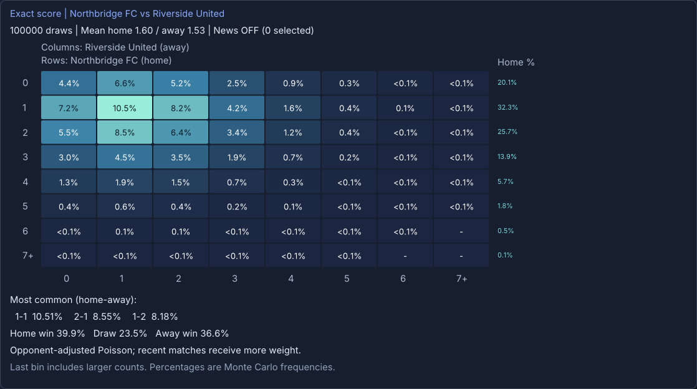

# Poisson Studio

A Windows desktop football probability app built with C++23, Dear ImGui, DirectX 11 and a private MySQL database.

Run 100 to 100 million simulations and explore percentage heatmaps for exact scores, total goals, corners, cards and shots on target. Inspect player lineups, review automatically selected availability news, compare betting markets against entered odds, and export PNG/CSV results.



*Example from the synthetic demo league.*

## Quick start on a new Windows PC

**Requirements:** Windows 10/11 x64, 64-bit PowerShell 5.1+, [Python 3.10+ x64](https://www.python.org/downloads/windows/), and the [Microsoft Visual C++ 2015–2022 x64 runtime](https://aka.ms/vs/17/release/vc_redist.x64.exe). Reserve about 4 GB of disk space for the downloaded toolchain, MySQL and build files. The app itself does not use Python at runtime.

1. Clone this repository or extract its source ZIP into a writable, short ASCII directory. Spaces in the path are supported; do not install under `Program Files`.
2. Double-click **Setup.cmd**, or run:

   ```powershell
   powershell -NoProfile -ExecutionPolicy Bypass -File .\setup.ps1 -Demo
   ```

3. Open **Launch.cmd**. The optional **Demo league (synthetic)** works immediately. To obtain real predictions, open **Data imports** and import a public competition or your own match CSV.

Setup downloads SHA-256-verified dependencies, builds locally, chooses a free localhost database port, and creates new credentials encrypted for your Windows account. It requires no football API key, Docker, Visual Studio installation, existing MySQL service, or copied database. Downloading prerequisites may require administrator access; the project setup itself installs into its own directory.

No real match history, player data, API keys or credentials are shipped in the repository. Public imports cover 22 competitions; player and historical coverage varies. Additional leagues can use CSV or an optional API-Football subscription.

## Documentation

| Guide | Contents |
| --- | --- |
| [Setup and troubleshooting](docs/SETUP.md) | Prerequisites, offline cache, ports, updates, moving folders and errors |
| [User guide](docs/USER_GUIDE.md) | Heatmaps, exports, players, news review and betting suggestions |
| [Data providers](docs/DATA.md) | League codes, CSV format, API limits and missing observations |
| [Model](docs/MODEL.md) | Poisson fitting, assumptions, ratings and news adjustments |
| [Architecture and database](docs/ARCHITECTURE.md) | Source map, data flow, schema and storage |
| [CLI and verification](docs/DEVELOPMENT.md) | Build options, command reference, deterministic tests and CI |
| [GitHub and releases](docs/RELEASING.md) | First push, source packaging, release procedure and checks |
| [Verification record](docs/VERIFICATION.md) | What was tested and remaining platform limits |

## Build, test and package

After setup:

```powershell
.\build.ps1
.\verify.ps1                         # Setup/package and model tests
.\verify.ps1 -Integration -Graphics  # Adds demo data and checks MySQL + rendered exports
python scripts/package_source.py    # Creates dist/PoissonStudio-<version>-source.zip
```

The Windows GitHub Actions workflow runs setup and the full test suite without football API credentials. Release ZIPs contain source, docs and licensed assets; generated binaries and private state are excluded by an explicit allowlist.

News effects and Studio player ratings are transparent heuristics. Increasing simulation count reduces sampling noise, not model error. Bet suggestions show model probabilities and, when odds are entered, model expected returns; they are not a claim of calibrated profitability.

## License

Project source is **GPL-2.0-only**, compatible with the MySQL Community client library used by the app. Inter is distributed under the SIL Open Font License. Other dependencies retain their own licenses; see [third-party notices](THIRD_PARTY_NOTICES.md). Football data are fetched separately and remain subject to their providers' terms.
