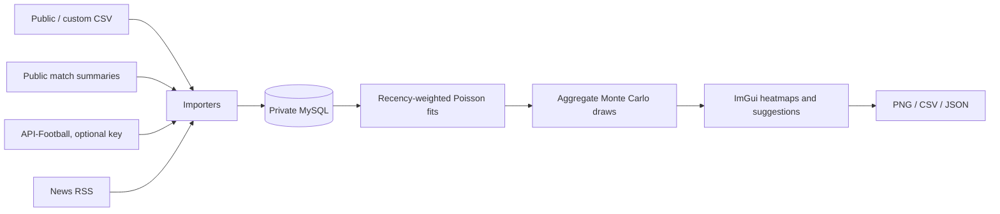

# Architecture and database

## Source map

| File | Responsibility |
| --- | --- |
| `src/main.cpp` | Win32 window, DirectX 11, PNG capture, CLI dispatch, server lifetime |
| `src/ui.cpp` / `ui.hpp` | ImGui pages, asynchronous jobs, exports and scenario controls |
| `src/core.cpp` / `core.hpp` | Date/CSV helpers, fitting, simulation and model tests |
| `src/features.cpp` | Player-minute reconstruction, local ratings, headline selection, market probabilities |
| `src/database.cpp` / `database.hpp` | MySQL access, schema/migrations, queries and upserts |
| `src/platform.cpp` | HTTPS, DPAPI, private MySQL initialization/start/stop |
| `src/providers.cpp` | Public CSV, custom CSV, API-Football and RSS adapters |
| `src/espn.cpp` | Public roster/statistics backfill and fixture matching |
| `src/demo.cpp` | Deterministic synthetic dataset and database integration check |
| `bootstrap.py` | Pinned dependency downloads, hashes and extraction |
| `scripts/` | CLI wrapper and source-release packager |

Imports and simulations run on a worker thread; UI snapshots are applied when jobs complete. Cancellation retains completed import transactions. MySQL connections are local to the owning operation/thread. Database SQL escapes strings through the MySQL client rather than interpolating unescaped source values.

## Database tables

| Table | Key and purpose |
| --- | --- |
| `league` | Shared league IDs, provider + external key uniqueness |
| `team` | Shared team IDs with provider-specific identity |
| `fixture` | League/date/home/away uniqueness; nullable goals, corners and cards |
| `team_match_extra` | Fixture/team key; shots, shots on target and other available totals |
| `player` | Provider + external player ID |
| `appearance` | Fixture/player key; lineup status, stats, minute source and separate Studio/provider ratings |
| `statistic_type` | Dictionary of additional provider statistic names |
| `appearance_stat` | Fixture/player/statistic key and numeric value |
| `match_event` | Fixture/sequence key; available events |
| `provider_fixture_link` | Links a public fixture to another provider's match ID |
| `injury` | Fixture/player availability records from API-Football |
| `news` | Team + URL hash; title/source, expiry, selection/review decisions and scenario effects |
| `import_state` | Source hashes and backfill checkpoints |

`Database::schema()` is the authoritative schema and contains additive column migrations. Application count arrays use `-1` for missing values; the database uses NULL. Small counts use compact integers; larger numeric player statistics use dictionary IDs and decimal fields. Table/index statistics are estimates; MySQL system tables and transaction logs consume additional space.

## Local state and credentials

`config.json` stores non-secret connection settings. `secrets.bin` contains DPAPI-encrypted database/API credentials for the current Windows user. The private database is under `data/mysql`, and server paths are written to `data/my.ini` at startup. The bind address is loopback only. A new setup chooses its own port and credentials; no Windows service is installed.

Source packages use an allowlist. Databases, cached football data, tool downloads, runtime logs, exports and credentials are excluded. The private server is shut down by a scope guard when an app-owned session exits through normal execution or a C++ exception. Forced process termination cannot run C++ cleanup; the next startup can reconnect to the existing private server.
